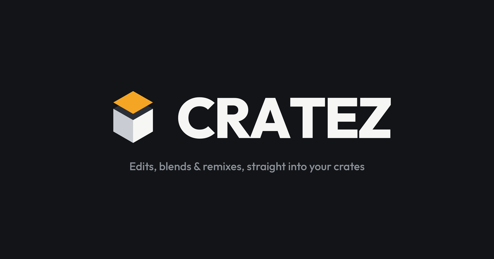
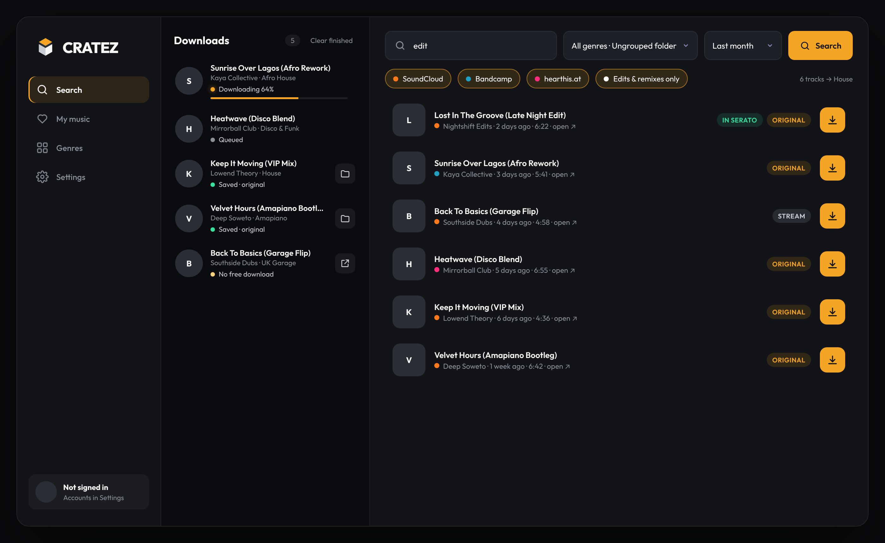
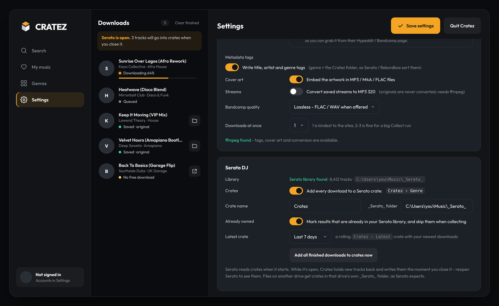

  

  <b>Find edits, blends, bootlegs and remixes on SoundCloud, Bandcamp and hearthis.at, download them in one click, and have them waiting in your Serato crates.</b>

  
  &nbsp;
  

Free · Windows 10/11 and macOS · No account needed

---

  

## How it works

  

- **Search by genre.** Pick House, Amapiano, UK Garage or any genre you set up, and Cratez searches all three sites at once for edits, flips, bootlegs and remixes.
- **One-click downloads.** You get the uploader's original file (WAV/MP3) when they offer it, with title, artist, genre and cover art filled in.
- **Straight into Serato.** Every track goes into a `Cratez › Genre` crate, and the newest ones also go into `Cratez › Latest`. You don't have to drag anything in.
- **No doubles.** Cratez reads your Serato library and marks tracks you already own with **IN SERATO**, and the weekly Collect skips them.
- **Your likes and purchases.** Sign in to pull your SoundCloud likes or everything you've bought on Bandcamp.

---

## Install it (no GitHub know-how needed)

### Windows

1. Click **[Download for Windows](https://github.com/jcnz90/cratez/releases/latest)**.
2. On the page that opens, scroll down to **Assets** and click **`Cratez-Setup-…exe`**. It saves to your Downloads folder.
3. Double-click the file you downloaded.
4. If a blue **"Windows protected your PC"** box appears, click **More info**, then **Run anyway**. That box shows up because Cratez is a small independent app without a paid certificate.
5. Click **Next** through the installer. You don't need an admin password.
6. Open **Cratez** from the Start menu.

### Mac

1. Click **[Download for Mac](https://github.com/jcnz90/cratez/releases/latest)**.
2. Under **Assets**, click **`Cratez-….dmg`**.
3. Open the downloaded file and drag the **Cratez** icon onto the **Applications** folder.
4. The first time only: open Applications, **right-click** Cratez and choose **Open**, then click **Open** again. After that it opens normally.

Tags, embedded cover art and MP3-320 conversion work out of the box: the installers include [ffmpeg](https://ffmpeg.org) (free software under the GPL; source at ffmpeg.org).

---

## Serato setup

  

Cratez finds your Serato library by itself. Open **Settings › Serato DJ** to check it says **Serato library found**.

- **Serato only reads crates when it starts.** If Serato is open while you download, Cratez holds the new tracks back and adds them to your crates the moment you close Serato. A note in the Downloads column tells you how many are waiting. Reopen Serato and they're there.
- **Cratez › Latest** always holds your last 7 days of downloads. You can switch it to 3, 14 or 30 days, or turn it off.
- Tracks on an external drive get their crates on that drive, which is where Serato looks for them.

---

## Using it

| | |
|---|---|
| **Search** | Pick a genre, type what you're after (or leave it blank), choose a time window and hit **Search**. Download one track, or **Download all**. You can also paste a link to a track, set, album, artist or likes page. |
| **My music** | Load your SoundCloud likes or Bandcamp purchases and download them into a folder. |
| **Genres** | Edit your genre list. **Collect** runs every search for a genre and queues new matches, and **Collect all genres** once a week keeps your crates fresh. |
| **Settings** | Sign in to SoundCloud/Bandcamp, choose where files go and how folders are named, and set audio quality and Serato options. |

### Signing in (optional)

SoundCloud likes and Bandcamp purchases need you to be signed in. In **Settings › Accounts**, paste the cookie shown there. Cratez shows where to find it, and the value stays on your computer.

---

## What gets downloaded

| Site | You get |
|---|---|
| **SoundCloud** | The uploader's original file when they've switched downloads on. If they haven't, you can choose to save the stream instead. |
| **hearthis.at** | The uploader's download file when offered, otherwise the stream (same setting). |
| **Bandcamp** | Free and name-your-price downloads, plus everything you've bought once you sign in (FLAC/WAV/MP3-320). Paid tracks you don't own are listed with a buy link and never ripped. |

Please support the artists: buy the tracks you play out.

---

## Help

- **Searches or downloads stopped working?** The sites change often. Download the newest Cratez from the [Releases page](https://github.com/jcnz90/cratez/releases/latest).
- **Tracks aren't showing in Serato?** Close and reopen Serato, since it only reads crates at startup. Then check **Settings › Serato DJ** shows your library.
- **Log file:** Windows `%APPDATA%\Cratez\cratez.log` · Mac `~/Library/Application Support/Cratez/cratez.log`

<b>Build it yourself (for developers)</b>

Needs Python 3.10+.

- **Windows:** double-click `build.bat`. You get `dist\Cratez.exe`, plus `dist\Cratez-Setup-*.exe` if [Inno Setup](https://jrsoftware.org/isinfo.php) is installed (`winget install JRSoftware.InnoSetup`).
- **Mac:** double-click `build.command`. You get `dist/Cratez.app` and `dist/Cratez-*.dmg`.
- To run without building, use `run.bat` / `run.command`.

Pushing a tag like `v1.2.0` runs the release workflow, which builds both installers and attaches them to a GitHub release.

